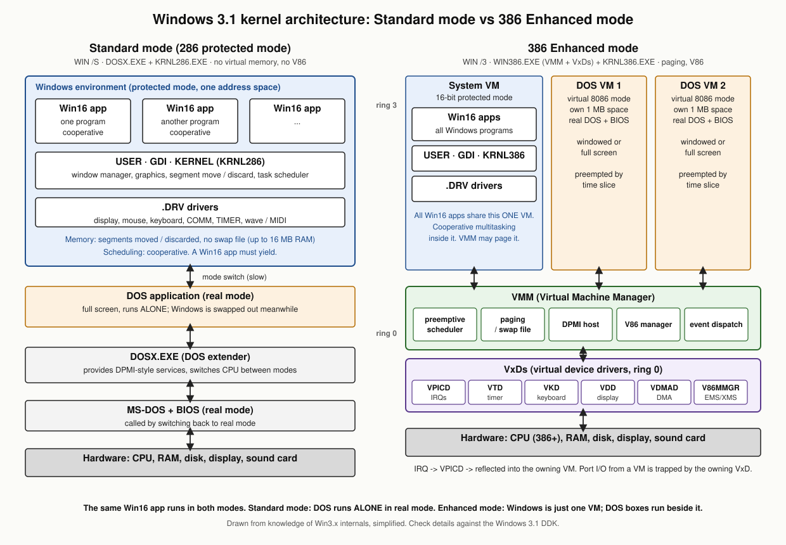
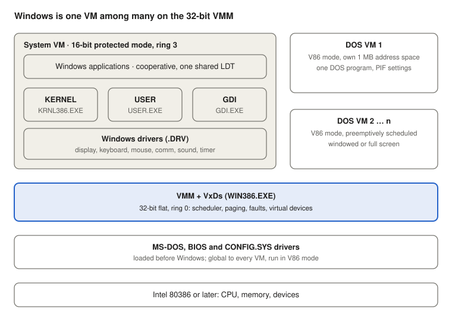
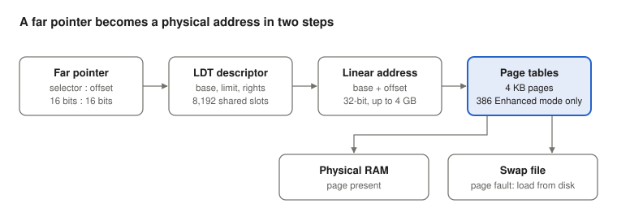
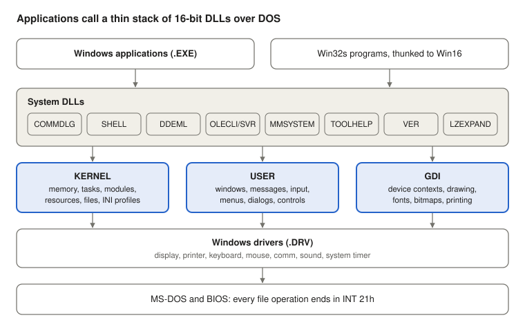
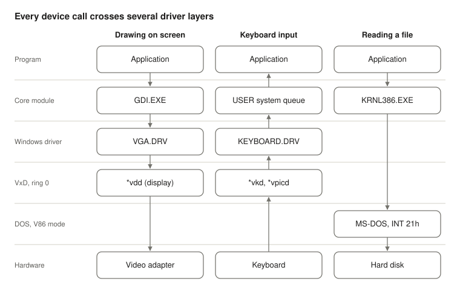
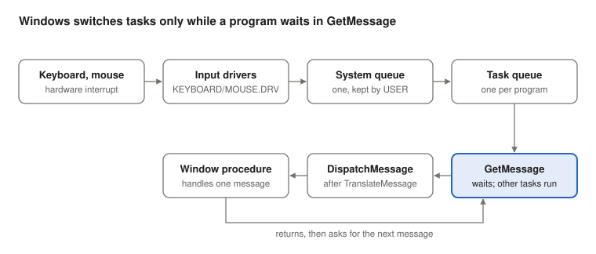

# Windows 3.1 architecture

*October 2026*

## Contents

1. [Overview](#overview)
2. [Operating modes and CPU modes](#operating-modes-and-cpu-modes)
3. [386 Enhanced mode architecture](#386-enhanced-mode-architecture)
4. [Memory model](#memory-model)
5. [Core modules and API space](#core-modules-and-api-space)
6. [Driver structure](#driver-structure)
7. [Behavior of 16-bit applications](#behavior-of-16-bit-applications)
8. [DOS programs and DPMI](#dos-programs-and-dpmi)
9. [Limits at a glance](#limits-at-a-glance)
10. [Sources](#sources)

## Overview

Windows 3.1 (April 1992) is a 16-bit, protected-mode graphical environment that runs on top of MS-DOS. DOS still owns the file system and boots the machine; Windows takes over the CPU, memory, screen and input once `WIN.COM` starts it.

It has two operating modes. Real mode, still present in Windows 3.0, was dropped, so a 80286 is the minimum CPU.

- **Standard mode** (`win /s`): 80286 or better, at least 1 MB of RAM. Windows runs in 16-bit protected mode through a DOS extender. DOS programs run full screen only, one at a time.
- **386 Enhanced mode** (`win /3`, the default on a 386 with enough memory): a 32-bit Virtual Machine Manager (VMM) takes control of the CPU. Windows runs in protected mode inside one virtual machine, and every DOS program gets its own virtual 8086 machine, windowed and preemptively multitasked.

Windows for Workgroups 3.11 (November 1993) dropped Standard mode and runs only in 386 Enhanced mode. The rest of this document describes Windows 3.1 unless 3.11 is named.

## Operating modes and CPU modes

In both modes, Windows and every Windows application run in 16-bit protected mode. The modes differ in what sits underneath Windows and how DOS programs run.

`WIN.COM` checks the CPU and memory and picks the mode, unless the user forces one with `/s` or `/3`. It then loads a different kernel and support layer for each mode:

| | Standard mode | 386 Enhanced mode |
| --- | --- | --- |
| Minimum CPU | 80286 | 80386 |
| Loader under Windows | `DOSX.EXE` (DOS extender) | `WIN386.EXE` (VMM + built-in VxDs) |
| Windows kernel | `KRNL286.EXE` | `KRNL386.EXE` |
| Windows and its apps | 16-bit protected mode | 16-bit protected mode, inside the system VM |
| DOS programs | Real mode, full screen, task-swapped to disk | V86 mode, each in its own VM, windowed or full screen |
| Multitasking of DOS programs | None (switching only) | Preemptive, time-sliced |
| Virtual memory | No | Yes, demand paging to a swap file |
| Address space | 16 MB (286 has 24 address lines) | 4 GB linear; about 256 MB usable in practice |

In Standard mode, a call to DOS or the BIOS makes `DOSX` switch the CPU back to real mode, run the call, and return to protected mode. On a 286 this switch is slow, because the CPU can only leave protected mode by a reset. In 386 Enhanced mode, the VMM instead runs DOS and BIOS code in V86 mode, without leaving protected mode.

Side by side: in Standard mode a DOS program takes over the machine alone, while in 386 Enhanced mode Windows is one VM next to the DOS VMs, all on top of the VMM and its VxDs.

## 386 Enhanced mode architecture

In 386 Enhanced mode, a small 32-bit operating system, the VMM, owns the machine, and Windows itself is just one of its clients.

- **VMM (Virtual Machine Manager)**: 32-bit flat-model code at ring 0, loaded from `WIN386.EXE`. It owns the interrupt and descriptor tables, the page tables and the scheduler. It creates virtual machines (VMs), switches between them, and handles every fault and trapped instruction.
- **VxDs (virtual device drivers)**: 32-bit ring 0 modules that extend the VMM. Each one virtualizes a piece of hardware or a service so several VMs can share it. Core VxDs are built into `WIN386.EXE`; others load from `.386` files.
- **System VM**: the one VM that runs Windows: `KRNL386.EXE`, `USER.EXE`, `GDI.EXE`, the Windows drivers, and all Windows applications. This code runs in 16-bit protected mode at ring 3 (Windows 3.0 used ring 1).
- **DOS VMs**: one per DOS program. Each is a V86-mode copy of the DOS machine, with its own 1 MB address space, registers and virtualized devices.

Windows and all its programs share the left box; each DOS program gets a box of its own, and the VMM below switches between them.

Every VM starts as a copy of the DOS environment that existed before Windows loaded. Drivers and TSRs loaded in `CONFIG.SYS` and `AUTOEXEC.BAT` are global, seen by all VMs. Anything started inside a DOS VM stays local to that VM.

The VMM schedules VMs preemptively with time slices, using the priorities set in each program's PIF file. Only the VMs are preempted: inside the system VM, Windows applications still take turns cooperatively, as [section 7](#behavior-of-16-bit-applications) explains.

## Memory model

A 16-bit Windows program never sees a flat address space: it addresses memory as segments of at most 64 KB, named by 16-bit selectors.

**Selectors and the LDT.** A far pointer is `selector:offset`. The selector indexes a descriptor that holds the segment's base, limit and access rights. All Windows applications share one Local Descriptor Table (LDT), which has room for 8,192 selectors in total.

**Movable segments.** Because code uses selectors, not physical addresses, Windows can move a segment in memory by changing only its descriptor's base. Real-mode Windows had to lock and fix up memory by hand; in protected mode, movement is invisible to the program. Segments can also be discardable: Windows throws away code and resources under memory pressure and reloads them from the `.EXE` or `.DLL` when touched.

**Global heap.** All memory Windows manages is one global heap, shared by every application. `GlobalAlloc` returns a handle to a block of up to about 16 MB in 386 Enhanced mode (about 1 MB in Standard mode). Blocks larger than 64 KB are reached with "huge" pointers that step across a run of selectors.

**Local heap.** Each application instance has one automatic data segment (`DGROUP`) of at most 64 KB. It holds the stack, static data and a local heap for `LocalAlloc`.

**Paging and the swap file.** In 386 Enhanced mode, the selector's base is a 32-bit linear address. The 386 paging unit maps it in 4 KB pages to physical RAM, or to the swap file when a page is not present. The swap file is either permanent (`386SPART.PAR`, a contiguous file set up in Control Panel) or temporary (`WIN386.SWP`). Standard mode has no paging, so it is limited to physical memory.

Segmentation turns a selector and offset into a linear address; paging then maps that to RAM or the swap file. In Standard mode the second step is missing, and the linear address is the physical address.

## Core modules and API space

The Windows 3.1 API, later called Win16, is a set of exported functions in 16-bit DLLs. Three core modules carry most of it; the rest is in system DLLs, many of them new in 3.1.

Applications link to these functions by module name and ordinal or name. The loader resolves the calls when the program starts, using the New Executable (NE) format shared by `.EXE`, `.DLL` and `.DRV` files.

The three core modules carry most calls; system DLLs add services on top of them, and applications may call either layer directly.

| Module | File | What it provides |
| --- | --- | --- |
| KERNEL | `KRNL286.EXE` / `KRNL386.EXE` | Memory (global and local heaps, selectors), tasks and scheduling, module loading, resources, atoms, `.INI` profile functions, file I/O through DOS |
| USER | `USER.EXE` | Windows and window classes, messages and queues, keyboard and mouse input, menus, dialog boxes, standard controls, clipboard, timers, hooks |
| GDI | `GDI.EXE` | Device contexts, drawing, pens, brushes, bitmaps, regions, fonts (TrueType new in 3.1), metafiles, printing |
| Common dialogs | `COMMDLG.DLL` | Standard Open, Save, Print, Font, Color and Find dialogs (new in 3.1) |
| Shell | `SHELL.DLL` | Drag and drop from File Manager, file associations and the registration database `REG.DAT` (new in 3.1) |
| DDE | `DDEML.DLL` | Dynamic Data Exchange Management Library on top of message-based DDE |
| OLE 1.0 | `OLECLI.DLL`, `OLESVR.DLL` | Object linking and embedding between applications |
| Multimedia | `MMSYSTEM.DLL` | Waveform audio, MIDI, timers, joystick, Media Control Interface (MCI) |
| Tool helper | `TOOLHELP.DLL` | Inspecting tasks, modules, heaps; fault handling for debuggers |
| Utilities | `VER.DLL`, `LZEXPAND.DLL` | Version resources and installers; expanding compressed setup files |

Windows 3.1 also added parameter validation to many API calls, so a bad handle or pointer often returns an error instead of crashing. The optional add-on Win32s let some 32-bit programs written for Windows NT run on Windows 3.1, translating a subset of Win32 calls into Win16 calls.

## Driver structure

Windows 3.1 has three layers of drivers, and one device can involve all three: a 16-bit Windows driver, a 32-bit VxD, and the real-mode DOS or BIOS code underneath.

Drawing goes down through GDI and the display driver, keyboard input comes up through the VxDs into USER's queue, and file access skips the Windows driver layer to reach DOS. With 32-bit disk access on, the `*int13` and `*wdctrl` VxDs catch DOS's disk calls and drive the hard disk without the BIOS.

**1. Windows drivers (`.DRV`, 16-bit, ring 3).** These are NE-format DLLs that the core modules call. They are listed in the `[boot]` and `[drivers]` sections of `SYSTEM.INI`.

| Driver | Example file | Called by |
| --- | --- | --- |
| Display | `VGA.DRV`, `SVGA256.DRV` | GDI, for all drawing on screen |
| Printer | `UNIDRV.DLL` + a mini-driver such as `HPPCL.DRV` | GDI, for printing |
| Keyboard | `KEYBOARD.DRV` | USER, for key input |
| Mouse | `MOUSE.DRV` | USER, for pointer input |
| Communications | `COMM.DRV` | USER and applications, for serial and parallel ports |
| System timer | `SYSTEM.DRV` | KERNEL and USER |
| Sound | `SOUND.DRV`, plus installable drivers for wave and MIDI | KERNEL and `MMSYSTEM.DLL` |

**2. Virtual device drivers (VxDs, 32-bit, ring 0).** Used in 386 Enhanced mode only, and listed as `device=` lines in the `[386Enh]` section of `SYSTEM.INI`. A name starting with `*` means the VxD is built into `WIN386.EXE`. Examples are `*vpicd` (interrupt controller), `*vtd` (timer), `*vkd` (keyboard), `*vdd` (display), `*vdmad` (DMA), `*pageswap` (swap file) and `*int13` with `*wdctrl` (32-bit disk access, which skips the BIOS for WD1003-compatible hard disks).

**3. DOS and BIOS drivers (real mode).** Drivers loaded from `CONFIG.SYS`, plus the BIOS itself. Windows still uses them for anything a VxD does not replace, such as the file system: in Windows 3.1 every file operation ends in an `INT 21h` call to DOS, run in real mode (Standard) or V86 mode (386 Enhanced). Windows for Workgroups 3.11 added 32-bit file access, a VxD file system that bypasses DOS for local disks.

**Grabbers** (`.2GR` for Standard mode, `.3GR` for 386 Enhanced) are a small extra driver class. They save and restore the screen of a DOS program and copy its contents to the clipboard.

## Behavior of 16-bit applications

A Windows 3.1 application is event-driven and must cooperate: it runs only when it asks Windows for its next message, and it lets others run only by asking again.

**The message loop.** Every program's `WinMain` ends in a loop of `GetMessage`, `TranslateMessage` and `DispatchMessage`. Hardware input first goes into one system queue. USER then moves each event into the queue of the task that owns the target window. `DispatchMessage` calls that window's procedure.

Input travels left to right into the program's queue; the program pulls it with `GetMessage`, and only while it waits there can another program run.

**Cooperative multitasking.** Windows switches tasks only inside calls such as `GetMessage`, `PeekMessage`, `WaitMessage` and `Yield`. A program that runs a long loop without calling them freezes every Windows program, because nothing can preempt it inside the system VM. The usual cures are to call `PeekMessage` during long work, or to split work into timer or idle steps. In 386 Enhanced mode, Ctrl+Alt+Del can end a hung application ("local reboot", new in 3.1).

**One shared address space.** All Windows applications live in the same VM and share one LDT. Nothing stops one program from reading or overwriting another's memory if it has a valid selector. Shared memory for DDE and the clipboard is simply a global block allocated with `GMEM_DDESHARE`.

**Instances and DLLs.** Several copies of one program share their code segments but each gets its own data segment. A DLL is loaded once for the whole system and has a single data segment shared by every program that calls it.

**System resources.** USER and GDI keep window, menu, brush, pen and font objects in their own small heaps. Program Manager's "System Resources" percentage reports the fullest of these. When they fill up, programs fail with out-of-memory errors even when many megabytes of RAM are free.

**Faults.** An invalid selector or an access past a segment's limit raises a general protection fault. Windows 3.1 reports it in the "General Protection Fault" dialog and ends the offending program; Windows 3.0 showed an "Unrecoverable Application Error" (UAE) instead. Because memory is shared, a bad program can still corrupt others before it faults.

## DOS programs and DPMI

DOS programs still live within the 1 MB DOS address space in every mode; only DPMI programs break out of it.

- **Standard mode:** a DOS program runs in real mode, full screen. When the user switches away, Windows writes its memory to a swap file on disk and the program stops until it is switched back.
- **386 Enhanced mode:** each DOS program runs in its own V86 VM, in a window or full screen, and keeps running in the background if its PIF allows. VxDs give each VM its own view of the keyboard, screen, timer and interrupts. The VMM can also give each VM expanded (EMS) and extended (XMS) memory.
- **PIF files** (`.PIF`, edited with PIF Editor) set each DOS program's memory needs, display mode, background execution and scheduling priority.
- **DPMI:** Windows 3.1 is a DOS Protected Mode Interface host (DPMI 0.9). A DOS program built with a DPMI-compatible DOS extender can switch to protected mode and use up to 16 MB of extended memory directly under 386 Enhanced mode, while Windows keeps control of the machine.

## Limits at a glance

The limits most programs hit first are the 64 KB segment, the shared USER and GDI heaps, and the 8,192 shared selectors, long before RAM runs out.

| Limit | Standard mode | 386 Enhanced mode |
| --- | --- | --- |
| Total memory | 16 MB | About 256 MB in practice (4 GB linear address space) |
| Virtual memory | None | Swap file, permanent or temporary |
| One segment, as 16-bit code sees it | 64 KB | 64 KB |
| One `GlobalAlloc` block | About 1 MB | About 16 MB |
| Selectors for all Windows programs | 8,192 (one shared LDT) | 8,192 (one shared LDT) |
| Data segment per program instance | 64 KB (stack + static data + local heap) | 64 KB |
| DOS program memory | Below 1 MB, full screen | Below 1 MB per VM; DPMI programs up to 16 MB |
| XMS driver | `HIMEM.SYS` must report all memory; older versions stop at 64 MB | Same |

## Sources

Memory and mode limits come from these pages. Module names, file names, VxD names and API details are general technical background without a cited page here.

- [Windows 3.1, Wikipedia](https://www.wikipedia.org/wiki/Windows_3.1): dropped real mode, 256 MB practical limit in 386 Enhanced mode
- [Microsoft application note WW0335, Windows 3.x memory](https://cdrom.classicistranieri.com/CICA_MS_Windows_CD-ROM_Walnut_Creek_November_1992/WIN3/MISC/WW0335/WW0335_1.TXT): modes, conventional memory, DPMI and 16 MB for DOS programs
- [The Register, Windows 3.1 at 30](https://www.theregister.com/2022/04/07/windows_3_1_30): 256 MB limit and the `HIMEM.SYS` caveat, WfW 3.11 dropping Standard mode
- [WinWorld forum, WfW 3.11 and RAM](https://forum.winworldpc.com/discussion/comment/154408): `HIMEM.SYS` 64 MB limit under MS-DOS 6.22
